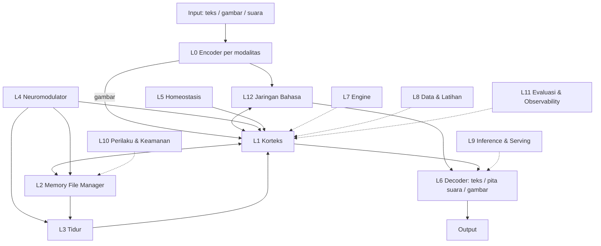
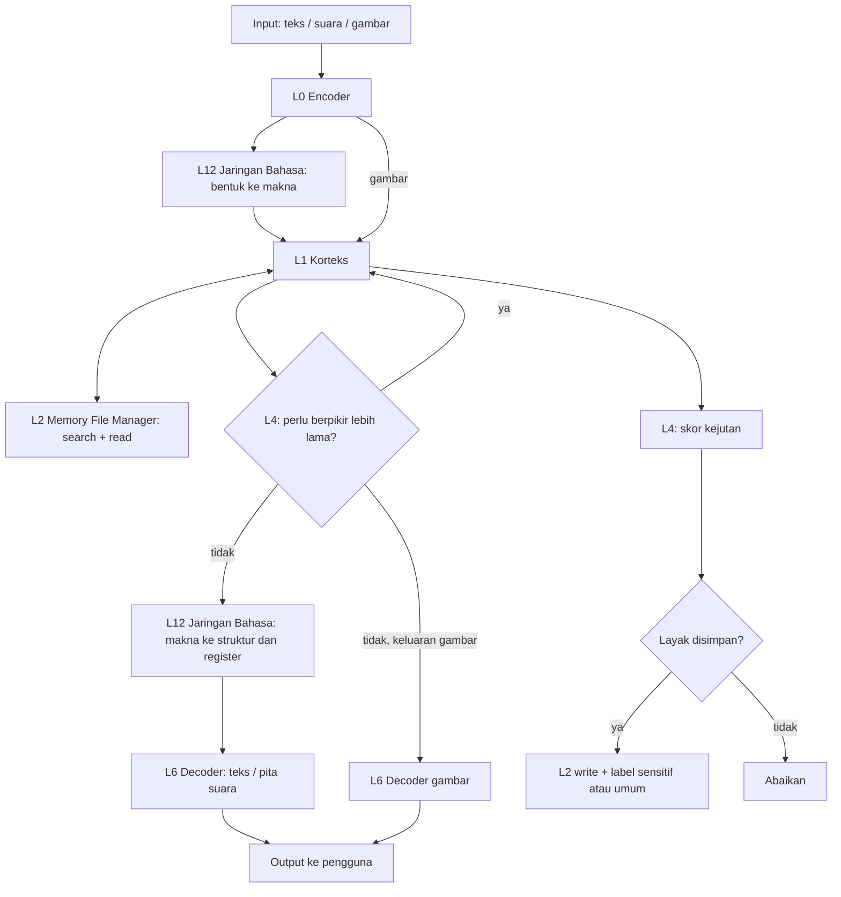
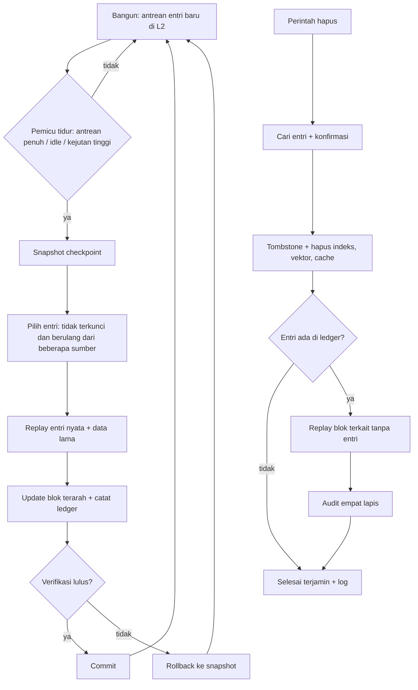
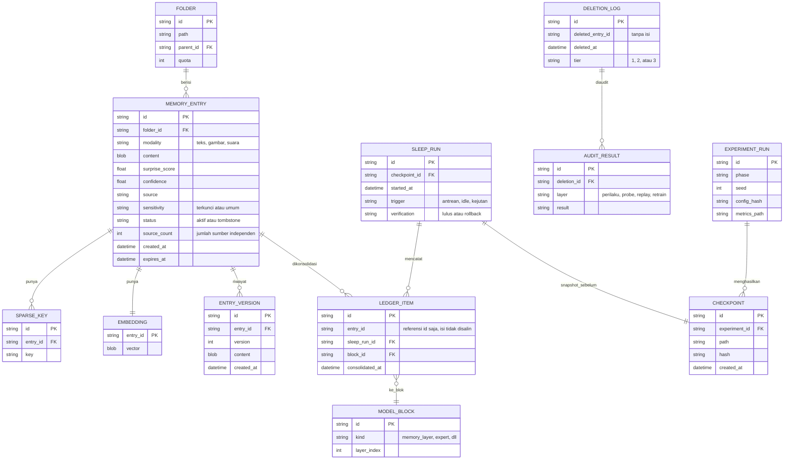

# PRD — RAK (Recurrent Adaptive Knowledge)

> **Versi:** Vbeta (permanen, tanpa nomor versi) · **Status:** dimulai ulang dari awal di harness baru (kode lama tidak dilanjutkan) · **Skala uji:** 100M parameter · **Implementasi:** Python + C++ (CUDA opsional) · **Target perangkat:** Termux (CPU), GitHub Actions (CPU), Kaggle (GPU)

---

## 1. Overview

### 1.1 Latar Belakang

LLM modern sangat kuat, tetapi punya lima kelemahan yang menjadi sasaran RAK:

- **Lupa saat belajar hal baru** (catastrophic forgetting).
- **Statis setelah dilatih**: tidak belajar dari pemakaian.
- **Boros data**.
- **Memori jangka panjang lemah**: hanya context window, dan pengetahuan spesifik sulit dihapus.
- **Jatah komputasi sama** untuk hal mudah maupun sulit.

Otak manusia menyelesaikan hal-hal ini dengan sistem memori cepat dan lambat, tidur (konsolidasi), sinyal kejutan, aktivasi sparse, penstabil otomatis, dan **area khusus bahasa** yang terpisah dari sistem penalaran. RAK mengambil **prinsip**-nya, bukan meniru biologi secara literal.

### 1.2 Hipotesis Inti

> Arsitektur rekuren sparse dengan memori eksternal yang bisa dicari dan dihapus, dilatih dengan siklus bangun–tidur dan diatur oleh sinyal kejutan, dengan jaringan bahasa khusus sebagai antarmuka antara bentuk dan makna, dapat **belajar terus tanpa melupakan ilmu lama** dan lebih hemat data dibanding Transformer atau hybrid pada ukuran dan compute yang sama.

Semua klaim lain (efisiensi, multimodal, suara natural) turunan dari hipotesis ini dan diuji lewat gate per fase.

### 1.3 Peta Layer

| Layer | Nama | Fungsi |
|---|---|---|
| L0 | Encoder | Mengubah teks, gambar, suara menjadi token (semua dilatih sendiri) |
| L1 | Korteks | Inti model: rekuren + attention lokal + slot sparse + loop adaptif |
| L2 | Memory File Manager | Memori eksternal: simpan, cari, baca, hapus |
| L3 | Tidur | Konsolidasi dari L2 ke bobot, dengan ledger, verifikasi, rollback |
| L4 | Neuromodulator | Sinyal kejutan/konflik yang mengatur penulisan memori, tidur, dan jatah komputasi |
| L5 | Homeostasis | Penstabil: normalisasi, penyeimbang slot, batas norma state |
| L6 | Decoder | Teks, suara (modul pita suara), gambar |
| L7 | Engine | Tensor, autograd, kernel C++/CUDA, binding Python |
| L8 | Data & Latihan | Pipeline data, loop latih, checkpoint |
| L9 | Inference & Serving | Sampling, state cache, streaming, API lokal |
| L10 | Perilaku & Keamanan | Format percakapan, kebijakan memori, perlindungan injeksi |
| L11 | Evaluasi & Observability | Benchmark, audit penghapusan, jejak keputusan |
| L12 | **Jaringan Bahasa** | Antarmuka bentuk ↔ makna: leksikon, morfologi, semantik, sintaksis, pragmatik |



### 1.4 Prinsip Desain (enam bagian otak)

1. **Korteks**: blok rekuren sparse sebagai inti; belajar lambat dan stabil.
2. **Hipokampus (Memory File Manager)**: belajar cepat, tulis sekali, bisa dicari dan dihapus; membaca tidak mengubah apa pun.
3. **Tidur**: konsolidasi dari memori cepat ke korteks, dengan pelacakan sumber.
4. **Neuromodulator**: sinyal kejutan yang mengatur seberapa kuat belajar dan seberapa banyak komputasi dipakai.
5. **Homeostasis**: penstabil otomatis supaya belajar tidak jebol.
6. **Jaringan Bahasa**: bahasa adalah **antarmuka** antara bentuk (teks/suara) dan makna, bukan tempat berpikir. Penalaran tetap di korteks dan fakta dunia tetap di Memory File Manager. Bentuknya "lunak": kapasitas khusus, tetapi tetap ada jalur bersama ke korteks.

### 1.5 Definisi "Mandiri"

RAK disebut mandiri jika memenuhi tiga syarat:

1. Dilatih **dari nol**, tanpa bobot pretrained milik siapa pun.
2. **Kode dan kernel inti ditulis sendiri** (tensor, autograd, op rekuren, memory layer, Memory File Manager).
3. **Tokenizer dan codec dilatih sendiri** dari data sendiri (termasuk "guru semantik" untuk codec suara).

Pembagian bahasa: **C++** untuk inti dan semua yang butuh kecepatan; **Python** untuk orkestrasi, konfigurasi, pipeline data, eksperimen, dan evaluasi. Komponen yang sudah dikenal (MoE, attention, rekurensi, VQ) boleh dipakai selama dibangun dan dilatih sendiri. PyTorch hanya boleh menjadi **penguji pembanding** di mesin dev, bukan bagian sistem.

### 1.6 Klaim yang Mau Dibuktikan dan Non-Goals

**Klaim:**

- **Utama:** RAK belajar terus dengan *forgetting* lebih rendah daripada baseline (Transformer dan hybrid) pada compute yang sama.
- **Kedua:** penghapusan pengetahuan spesifik yang **terukur** (audit empat lapis), bukan penghapusan mutlak.
- **Ketiga:** satu inti yang sama melayani teks, suara (TTS dan speech-to-speech), dan gambar.
- **Keempat:** Jaringan Bahasa "lunak" menunjukkan **disosiasi** ala otak (lesion test: bahasa anjlok, penalaran dan recall fakta tidak) dan tidak lebih buruk dari baseline end-to-end.

**Non-goals:**

- Menyaingi LLM besar di skala umum pada tahap ini (itu harapan jangka panjang, bukan target Vbeta).
- Klaim "lebih bagus dari semua arsitektur". Klaim selalu terbatas pada tugas dan ukuran yang diuji.
- Menjamin penghapusan pengaruh sebuah item dari bobot secara mutlak (riset unlearning belum menyediakan jaminan itu).
- Produk akhir siap pakai massal.

### 1.7 Risiko Utama dan Mitigasi

| Risiko | Dampak | Mitigasi |
|---|---|---|
| Arsitektur baru kalah dari Transformer 100M biasa | Hipotesis gugur | Baseline Transformer **dan** hybrid modern di data dan compute sama; gate per fase; hasil negatif tetap dilaporkan |
| Modul berhenti di kerangka atau versi ringan | Gate tampak lolos tapi tidak bermakna | Definition of Done (2.5), status ASLI/RINGAN/KERANGKA di `docs/STATUS.md`, larangan stub |
| Terlalu banyak komponen baru sekaligus | Tidak tahu mana yang bekerja | Bangun bertahap, ablasi di tiap gate |
| Compute terbatas (Kaggle GPU mingguan, Termux CPU) | Latihan 100M tidak selesai | Prototipe 10–30M dulu; checkpoint dan resume; anggaran compute per fase (F1.4) |
| Bug numerik pada autograd tulis sendiri | Model belajar buruk tanpa error | Gradient check numerik di setiap op, test determinisme |
| Konsolidasi (tidur) merusak model | Lupa atau kolaps | Verifikasi sebelum commit, checkpoint, rollback |
| Penghapusan tidak terjamin untuk yang sudah dikonsolidasi | Klaim privasi lemah | Item sensitif **terkunci** (tidak dikonsolidasi); audit empat lapis; klaim "terhapus terukur" |
| Jaringan Bahasa lunak lebih buruk dari end-to-end | Menambah kompleksitas tanpa untung | Ablasi wajib di G2 dan G7; boleh dibuang atau disederhanakan jika kalah |
| Jatah kapasitas bahasa di 100M sempit | Bahasa atau penalaran kekurangan parameter | Uji beberapa jatah (titik awal tebakan: 2%, 5%, 10%), tentukan lewat ablasi |
| Batas "bahasa" vs "pengetahuan" kabur | Fakta bocor ke Jaringan Bahasa dan sulit dihapus | Aturan: tata bahasa, kosakata, gaya di L12; fakta dunia di L2 |
| Bukti byte-patch dan sparse memory berasal dari skala lain | Tidak berlaku di 100M | Pembanding BPE dan FFN biasa; ablasi |
| Isi memori berisi instruksi jahat (injeksi) | Perilaku dibajak | Isi memori diperlakukan sebagai data, bukan perintah |
| Kualitas suara dan gambar rendah di model kecil | Hasil mengecewakan | Urutan bangun teks → suara → gambar; ekspektasi dicatat; gate kualitas |

### 1.8 Keputusan Terbuka

1. **BLAS/cuBLAS** untuk perkalian matriks? Default: tulis GEMM sederhana sendiri dulu; BLAS opsional jika kecepatan jadi hambatan.
2. **Autograd** tulis sendiri (default). Jika waktu jadi masalah, PyTorch boleh jadi host sementara untuk bagian non-inti; diputuskan di gate G0.
3. Ambang angka pada gate (G2 sampai G10) dikalibrasi setelah baseline Fase 1 selesai.
4. Ketersediaan `nvcc` di notebook Kaggle perlu dicek (T0.1.4).
5. Jatah kapasitas Jaringan Bahasa: titik awal 2%, 5%, 10% adalah tebakan, bukan hasil riset.

---

## 2. Requirements

### 2.1 Functional Requirements

| ID | Requirement | Layer | Fase |
|---|---|---|---|
| FR-01 | Engine tensor + autograd tulis sendiri, lolos gradient check | L7 | 0 |
| FR-02 | Binding Python, scaffolding repo, aturan kerja untuk harness AI | L7 | 0 |
| FR-03 | Pipeline data, baseline Transformer dan hybrid, harness evaluasi | L8, L11 | 1 |
| FR-04 | Encoder teks byte-patch berbasis entropi (pembanding BPE) | L0 | 2 |
| FR-05 | Jaringan Bahasa tahap A: leksikon dan morfologi Indonesia | L12 | 2 |
| FR-06 | Korteks: rekuren + attention lokal + slot FFN yang bisa diganti | L1 | 2–3 |
| FR-07 | Slot sparse (MoE dan memory layer) + loop kedalaman adaptif | L1 | 3 |
| FR-08 | Homeostasis (normalisasi, penyeimbang slot) | L5 | 3 |
| FR-09 | Memory File Manager: read, search, write, update, delete | L2 | 4 |
| FR-10 | Gerbang tulis berbasis kejutan, dedup, kuota, TTL, penanda sensitif | L2, L4 | 4–5 |
| FR-11 | Tidur: replay dari entri nyata, ledger, verifikasi, rollback | L3 | 5 |
| FR-12 | Penghapusan bertingkat + audit empat lapis | L2, L3, L11 | 5 |
| FR-13 | Studi continual learning di skala 100M | semua | 6 |
| FR-14 | Jaringan Bahasa tahap B–E: semantik, sintaksis, pragmatik, evaluasi neurosains | L12 | 7 |
| FR-15 | Suara: codec 12.5 Hz, modul pita suara, TTS, speech-to-speech full-duplex | L0, L6 | 8 |
| FR-16 | Gambar: tokenizer 1D, pemahaman dan generate gambar kecil | L0, L6 | 9 |
| FR-17 | Inference streaming, API lokal, perilaku dasar, keamanan memori | L9, L10 | 10 |
| FR-18 | Dokumentasi, ADR, rilis, rencana skala besar | — | 11 |

### 2.2 Non-Functional Requirements

| ID | Requirement | Target |
|---|---|---|
| NFR-01 | Portabel | Build dan test hijau di Termux (aarch64, clang), GitHub Actions (CPU), Kaggle (GPU, CUDA) |
| NFR-02 | CUDA opsional | Seluruh sistem jalan di CPU; CUDA hanya aktif lewat flag build |
| NFR-03 | Paritas CPU–GPU | Hasil op sama dalam toleransi numerik yang ditetapkan |
| NFR-04 | Reproducible | Seed dicatat, minimal 3 seed per hasil utama, laporan mean ± std |
| NFR-05 | Determinisme | Latihan dan evaluasi bisa diulang persis pada mesin yang sama |
| NFR-06 | Skala | Prototipe 10–30M, uji utama 100M |
| NFR-07 | Memori | Inferensi dan MFM berjalan dalam batas RAM Termux; jumlah entri MFM dibatasi per konfigurasi |
| NFR-08 | Latensi suara | Respons pertama speech-to-speech < 300 ms pada GPU (target) |
| NFR-09 | Keamanan memori | Isi MFM diperlakukan sebagai data; item sensitif tidak pernah masuk bobot |
| NFR-10 | Mandiri | Memenuhi tiga syarat pada 1.5 |
| NFR-11 | Status jujur | Tiap modul punya status di `docs/STATUS.md`; tidak ada klaim "selesai" tanpa status ASLI |
| NFR-12 | Python + C++ | Inti C++, binding lewat pybind11/nanobind, build dengan CMake satu perintah per lingkungan |

### 2.3 Constraints dan Asumsi

- Proyek **dimulai ulang dari awal** di harness AI coding baru; tidak ada kode lama yang dilanjutkan.
- Tim: 1 orang, dibantu AI untuk menulis kode (asumsi dari diskusi).
- Anggaran: nol atau mendekati nol; mengandalkan Kaggle gratis, GitHub Actions, dan perangkat Termux (asumsi dari PRD lama, perlu dikonfirmasi).
- Data: hanya data dengan lisensi yang jelas; lisensi dicatat per dataset.
- Backprop **boleh** dipakai; mekanisme otak (memori, tidur, neuromodulator, homeostasis, jaringan bahasa) tetap menjadi sumber keunikan.

### 2.4 Metrik dan Gate Keberhasilan

| Metrik | Cara ukur | Dipakai di |
|---|---|---|
| Bits-per-byte / perplexity | Data validasi dan uji tetap | G2, G3, G6, G7 |
| **Forgetting** | Penurunan skor di domain lama setelah belajar domain baru | G5, G6 |
| Forward transfer / sample efficiency | Kurva belajar per jumlah contoh | G6 |
| Recall persis dari MFM | exact@k pada N entri | G4 |
| Latensi MFM | ms per `search` pada N entri di Termux | G4 |
| Audit penghapusan | Empat lapis: perilaku, probe representasi, replay-recovery, banding retrain kecil | G5 |
| Akurasi morfologi | Imbuhan, reduplikasi, kata baru, typo (Bahasa Indonesia) | G2, G7 |
| Lesion test bahasa | Matikan unit bahasa vs unit acak; ukur bahasa, penalaran, recall fakta | G7 |
| Kontrol register | Diminta santai atau formal, keluaran sesuai tanpa merusak makna | G7 |
| Latensi respons suara | ms dari akhir ucapan ke token suara pertama | G8 |
| Kualitas suara | Intelligibility (CER lewat ASR kecil sendiri atau uji dengar) | G8 |
| Kualitas gambar | FID kecil / uji visual pada resolusi kecil | G9 |

**Gate** adalah titik keputusan di akhir tiap fase: lanjut, perbaiki, atau berhenti dan analisis. Ambang angka ditetapkan setelah baseline Fase 1 selesai.

### 2.5 Definition of Done dan Status Modul

Sebuah modul baru boleh disebut **ASLI** hanya jika memenuhi semua poin berikut:

1. **Lengkap** sesuai fitur dan subfitur di PRD (sebut ID task yang dicakup), termasuk edge case: input kosong, ukuran 0 atau 1, NaN/Inf, overflow, UTF-8 tidak valid, batas memori.
2. **Numerik benar**: gradient check, kestabilan (softmax/log-sum-exp, norm), determinisme dengan seed.
3. **Konfigurasi dan error**: parameter lewat config, input divalidasi, error jelas, tidak crash diam-diam.
4. **Test lengkap**: unit, properti (invarian, input acak), regresi, kasus negatif, dan paritas CPU vs CUDA bila CUDA aktif. Setiap fungsi publik punya test yang tidak tautologis.
5. **Benchmark** kecepatan dan memori, termasuk di Termux.
6. **Data real**: modul yang punya metrik di PRD diuji di data real (bukan hanya sintetis), minimal 3 seed (mean ± std).
7. **Dokumentasi**: ide, kompleksitas, dan batasan di header; README singkat per modul; ADR bila ada keputusan.
8. **Observability**: logging dan metrik internal untuk debugging.

**Status modul** (dicatat di `docs/STATUS.md`, wajib diperbarui tiap perubahan):

- **ASLI**: lolos Definition of Done dan diukur di data real.
- **RINGAN**: jalan di data mainan atau belum lengkap.
- **KERANGKA**: antarmuka saja.
- **BELUM DIMULAI**.

**Larangan:** stub, `pass`, return konstanta, TODO yang dibiarkan, copy-paste berulang, padding baris, test yang selalu lulus, dan hasil yang di-hardcode atau dikarang. Kompleksitas diukur dari fungsi nyata dan bukti, bukan jumlah baris.

---

## 3. Core Features

Pecahan fase ada di dalam bagian ini. Tiap **fitur** punya **Idea** (penjelasan rinci), **Risiko**, dan **Tasks**. Fitur boleh punya **subfitur**, dan setiap subfitur juga punya Idea dan Tasks sendiri. Tiap fase ditutup dengan **Gate**.

---

### FASE 0 — Fondasi Engine, Binding Python, dan Scaffolding (L7)

**Tujuan:** engine tulis sendiri yang jalan di Termux, GitHub Actions, dan Kaggle, serta terbukti benar secara numerik.
**Gate G0:** semua op lolos gradient check; build dan test hijau di tiga lingkungan; hasil CPU dan CUDA sama dalam toleransi; modul native bisa diimpor dari Python dan paritas Python–C++ terbukti; struktur repo, `AGENTS.md`, dan `docs/STATUS.md` sudah ada.

#### F0.1 Build dan Portabilitas

**Idea:** satu basis kode C/C++ yang dibangun dengan CMake dan bisa dikompilasi di tiga tempat: Termux (aarch64, clang), GitHub Actions (x86-64, gcc/clang), dan Kaggle (x86-64 + GPU). CUDA dibuat opsional lewat flag `RAK_CUDA` (default mati), sehingga seluruh sistem selalu bisa jalan di CPU. Deteksi fitur CPU (NEON/AVX) saat kompilasi supaya kode cepat di tiap perangkat.

**Risiko:** perbedaan toolchain antar lingkungan; `nvcc` belum tentu tersedia di Kaggle; kompilasi di Termux lambat.

**Tasks:**
- [ ] T0.1.1 Struktur repo dan CMake dengan opsi `RAK_CUDA` (default OFF)
- [ ] T0.1.2 Build bersih di Termux (clang, aarch64)
- [ ] T0.1.3 CI GitHub Actions: build dan test CPU di setiap commit
- [ ] T0.1.4 Cek ketersediaan `nvcc` di notebook Kaggle dan skrip build CUDA
- [ ] T0.1.5 Dispatch fitur CPU (NEON/AVX) dengan fallback skalar

#### F0.2 Tensor dan Autograd Mini

**Idea:** pustaka tensor n-dimensi (float32 dulu, bf16/fp16 menyusul) dengan alokator arena supaya alokasi murah dan memori terprediksi. Autograd mode-balik (reverse-mode): setiap op mencatat dirinya di graf (tape), dan setiap op punya `forward` dan `backward` yang ditulis tangan. Ini menggantikan PyTorch sepenuhnya dan membuat setiap bug bisa ditelusuri.

**Risiko:** gradien salah tidak menimbulkan error; hanya membuat model belajar buruk.

**Tasks:**
- [ ] T0.2.1 Struktur tensor (shape, stride, dtype, buffer) dan alokator arena
- [ ] T0.2.2 Graf komputasi (tape) dan `backward()` mode-balik
- [ ] T0.2.3 Akumulasi gradien, pelepasan memori graf setelah backward
- [ ] T0.2.4 Dukungan broadcast dan view tanpa salin
- [ ] T0.2.5 Serialisasi tensor (format sendiri, mmap)

#### F0.3 Op Inti

**Idea:** hanya op yang benar-benar dibutuhkan RAK, supaya jumlah kode yang harus dijaga kecil. Setiap op wajib punya gradient check sebelum dipakai.

##### F0.3.1 Op Dasar

**Idea:** fondasi yang dipakai semua layer: perkalian matriks (GEMM), elementwise (tambah, kali, aktivasi), reduksi, normalisasi (RMSNorm), softmax, dan embedding (gather) beserta backward-nya. GEMM ditulis sendiri dengan tiling sederhana lebih dulu; optimasi menyusul setelah semuanya benar.

**Tasks:**
- [ ] T0.3.1.1 GEMM tiled (CPU) + backward
- [ ] T0.3.1.2 Elementwise (add, mul, SiLU/GELU) + backward
- [ ] T0.3.1.3 Reduksi (sum, mean, max) + backward
- [ ] T0.3.1.4 RMSNorm dan softmax stabil secara numerik + backward
- [ ] T0.3.1.5 Embedding gather dan scatter-add (backward)
- [ ] T0.3.1.6 Gradient check numerik untuk semua op di atas

##### F0.3.2 Op Khusus RAK

**Idea:** op yang membedakan RAK dari Transformer biasa: (a) **scan rekuren** (rekurensi linear bergerbang, paralel saat latih dan berurutan saat generasi), (b) **attention lokal** (jendela geser), (c) **lookup sparse top-k** untuk memory layer (kunci produk: pilih sedikit slot dari banyak), (d) **update sparse** (hanya slot terpilih yang diperbarui). Ini inti efisiensi dan belajar terus.

**Tasks:**
- [ ] T0.3.2.1 Scan rekuren bergerbang (maju, mundur, mode paralel dan berurutan)
- [ ] T0.3.2.2 Attention jendela geser + backward
- [ ] T0.3.2.3 Lookup top-k kunci produk + backward ke slot terpilih
- [ ] T0.3.2.4 Update sparse (scatter) yang menyentuh slot terpilih saja
- [ ] T0.3.2.5 Gradient check dan uji kesetaraan mode paralel vs berurutan

#### F0.4 Optimizer dan Loop Latihan

**Idea:** AdamW, jadwal learning rate, gradient clipping, dan checkpoint yang bisa **dilanjutkan persis** (resume deterministik). Ini penting karena sesi Kaggle terbatas waktu: latihan harus bisa dipotong dan disambung tanpa mengubah hasil.

**Risiko:** resume yang tidak persis membuat hasil tidak bisa direproduksi.

**Tasks:**
- [ ] T0.4.1 AdamW dan jadwal learning rate (warmup + cosine)
- [ ] T0.4.2 Gradient clipping dan pelacakan norma gradien
- [ ] T0.4.3 Checkpoint: bobot, state optimizer, state RNG, posisi data
- [ ] T0.4.4 Resume deterministik, diuji dengan memotong latihan di tengah
- [ ] T0.4.5 Presisi campuran (opsional) setelah versi fp32 benar

#### F0.5 Backend CUDA

**Idea:** CUDA hanya untuk op yang panas: GEMM, scan rekuren, lookup sparse. Setiap kernel CUDA wajib punya pasangan CPU sebagai referensi, dan keduanya diuji kesetaraannya. Kalau CUDA tidak ada, sistem tetap jalan di CPU.

**Risiko:** bug kernel yang hanya muncul di ukuran tertentu; sesi GPU Kaggle terbatas.

**Tasks:**
- [ ] T0.5.1 Manajemen memori device dan transfer host–device
- [ ] T0.5.2 Kernel GEMM CUDA (tiling shared memory)
- [ ] T0.5.3 Kernel scan rekuren dan lookup sparse CUDA
- [ ] T0.5.4 Uji paritas CPU vs CUDA pada berbagai ukuran
- [ ] T0.5.5 Benchmark CPU vs CUDA, dicatat per perangkat

#### F0.6 Test dan Benchmark Harness

**Idea:** kerangka test yang jalan di semua lingkungan: gradient check numerik (bandingkan gradien analitik dengan selisih hingga), uji determinisme (dua kali jalan, hasil sama), dan benchmark per op. PyTorch **boleh** dipakai di mesin dev hanya sebagai pembanding hasil; bukan bagian sistem.

**Tasks:**
- [ ] T0.6.1 Kerangka test header-only (mis. Catch2/doctest) yang jalan di Termux
- [ ] T0.6.2 Utilitas gradient check numerik generik
- [ ] T0.6.3 Uji determinisme (ulang dua kali, bandingkan bit-per-bit)
- [ ] T0.6.4 Benchmark per op dan laporan otomatis di CI
- [ ] T0.6.5 Skrip pembanding opsional dengan PyTorch (dev saja)

#### F0.7 Binding Python dan Paket

**Idea:** inti ditulis di C++, tetapi semua orkestrasi (konfigurasi, pipeline data, eksperimen, evaluasi, plot) ditulis di Python. Jembatannya adalah modul native yang dibuat dengan pybind11 atau nanobind dan dibangun lewat CMake. Tensor dibagi tanpa salin lewat buffer protocol (dan numpy bila tersedia), sehingga Python tidak menjadi hambatan kecepatan. Satu loader (`_native`) memuat modul native dan menyediakan error yang jelas jika modul belum terbangun.

**Risiko:** build ekstensi native di Termux bisa rewel; salinan data tersembunyi antara Python dan C++ memperlambat latihan.

**Tasks:**
- [ ] T0.7.1 Target CMake untuk modul native (`_rak`) di tiga lingkungan
- [ ] T0.7.2 Binding Tensor dengan buffer protocol (tanpa salin) dan interop numpy opsional
- [ ] T0.7.3 Binding op dan autograd (maju dan mundur) ke Python
- [ ] T0.7.4 Paket Python `rak` (src layout) dengan loader `_native` dan pesan error jelas
- [ ] T0.7.5 Uji paritas: hasil op via Python sama dengan C++ langsung
- [ ] T0.7.6 Pemasangan lokal (editable install) yang jalan di Termux

#### F0.8 Scaffolding dan Aturan Kerja Harness

**Idea:** struktur direktori (lihat 6.2) dibuat sejak hari pertama, bersama berkas aturan kerja untuk harness AI coding (`AGENTS.md`): Definition of Done, larangan stub, urutan fase, dan kewajiban memperbarui `docs/STATUS.md`. Tujuannya agar siapa pun (manusia atau AI) yang membuka repo langsung tahu aturan main dan status tiap modul, dan agar versi "ringan" tidak lagi diklaim selesai.

**Risiko:** aturan yang tidak ditegakkan di CI hanya jadi dokumen.

**Tasks:**
- [ ] T0.8.1 Buat struktur direktori dan README singkat per folder utama
- [ ] T0.8.2 `AGENTS.md`: aturan kerja, Definition of Done, larangan, urutan fase
- [ ] T0.8.3 `docs/STATUS.md`: tabel status modul dan aturan pembaruan
- [ ] T0.8.4 `.gitignore` (build, data, checkpoint, hasil run besar, `__pycache__`)
- [ ] T0.8.5 CI GitHub Actions: build, test C++ dan Python, cek `STATUS.md` ikut berubah saat modul berubah (opsional)
- [ ] T0.8.6 ADR awal: engine, mandiri, Python + C++, jaringan bahasa lunak

---

### FASE 1 — Data, Baseline, dan Evaluasi (L8, L11)

**Tujuan:** punya data bersih, baseline kuat, dan alat ukur yang bisa dipercaya **sebelum** membangun hal baru. Tanpa ini, klaim apa pun tidak bermakna.
**Gate G1:** dua baseline (Transformer dan hybrid) terlatih; harness evaluasi menghasilkan angka yang konsisten antar seed (std kecil); anggaran compute tercatat.

#### F1.1 Pipeline Data

**Idea:** alur data dari mentah ke shard biner siap latih: pengumpulan, pembersihan, deduplikasi, filter kualitas, pembagian train/validasi/uji yang **tidak bocor**, dan pencatatan lisensi per sumber. Sampler membaca shard secara streaming supaya muat di memori kecil (Termux). Kandidat data teks: Wikipedia Indonesia dan korpus web Indonesia (lisensi dan kualitas diverifikasi dulu), dan korpus cerita pendek berukuran kecil untuk prototipe cepat.

**Risiko:** kualitas dan lisensi data; kebocoran antara train dan uji; ukuran data vs memori perangkat.

**Tasks:**
- [ ] T1.1.1 Daftar sumber data + lisensi + catatan kualitas
- [ ] T1.1.2 Pembersihan, normalisasi, filter bahasa dan kualitas
- [ ] T1.1.3 Deduplikasi (hash dan near-duplicate) dan cek kebocoran train/uji
- [ ] T1.1.4 Format shard biner dan sampler streaming (mmap)
- [ ] T1.1.5 Set uji tetap dan set "domain berurutan" untuk uji continual

#### F1.2 Baseline

**Idea:** dua pembanding yang ditulis dengan engine sendiri: (1) Transformer decoder murni, (2) **hybrid** rekuren + attention lokal tanpa komponen RAK lain. Hybrid wajib ada karena arsitektur modern sudah banyak memakai pola itu; mengalahkan Transformer polos saja tidak cukup untuk membuktikan apa pun. Ukuran: prototipe 10–30M dan 100M dengan data dan compute yang sama.

**Risiko:** baseline yang lemah membuat kemenangan semu.

**Tasks:**
- [ ] T1.2.1 Transformer decoder di engine sendiri (10–30M)
- [ ] T1.2.2 Hybrid rekuren + attention lokal (10–30M)
- [ ] T1.2.3 Latih keduanya dengan data, token, dan compute yang sama
- [ ] T1.2.4 Skala baseline ke 100M (dijadwalkan di Fase 6)
- [ ] T1.2.5 Catat konfigurasi, seed, dan kurva latihan

#### F1.3 Harness Evaluasi

**Idea:** alat ukur yang dipakai semua fase: bits-per-byte, tugas continual (belajar domain A lalu B, ukur lupa di A), forgetting dan forward transfer, recall dari memori, dan kerangka audit penghapusan (diisi di Fase 5). Hasil selalu dalam mean ± std dari beberapa seed, dan laporan dibuat otomatis.

**Tasks:**
- [ ] T1.3.1 Metrik bits-per-byte dan perplexity
- [ ] T1.3.2 Protokol continual: urutan domain, matriks skor, forgetting, forward transfer
- [ ] T1.3.3 Evaluator recall (exact@k) untuk memori
- [ ] T1.3.4 Kerangka audit penghapusan (stub, diisi di Fase 5)
- [ ] T1.3.5 Laporan otomatis (tabel mean ± std, minimal 3 seed)

#### F1.4 Anggaran Komputasi

**Idea:** tabel realistis berapa jam compute tersedia di tiap lingkungan (Termux CPU, Actions CPU, Kaggle GPU per minggu) dan ukuran model/data yang muat di tiap fase. Ini mencegah rencana yang tidak mungkin dijalankan.

**Tasks:**
- [ ] T1.4.1 Ukur kecepatan latih (token/detik) di tiap lingkungan
- [ ] T1.4.2 Hitung kebutuhan latihan 10–30M dan 100M dalam jam
- [ ] T1.4.3 Susun jadwal sesi Kaggle dengan checkpoint dan resume
- [ ] T1.4.4 Tetapkan ambang gate G2–G6 berdasarkan baseline

---

### FASE 2 — Inti Teks dan Bahasa Tahap A (L0 teks, L1 dasar, L6 teks, L12 tahap A)

**Tujuan:** model teks kecil (10–30M) yang sudah memakai komponen RAK paling dasar, untuk memastikan inti tidak lebih buruk dari baseline.
**Gate G2:** bits-per-byte RAK-core tidak lebih buruk dari hybrid baseline melebihi ambang yang ditetapkan di T1.4.4. Jika jauh lebih buruk, berhenti dan analisis sebelum menambah komponen. Tambahan untuk Jaringan Bahasa tahap A: lebih baik pada kata berimbuhan dan typo dibanding tanpa modul, tanpa menurunkan bits-per-byte umum.

#### F2.1 Encoder Teks Byte-Patch

**Idea:** teks dibaca sebagai byte mentah tanpa kosakata tetap. Byte dikelompokkan menjadi patch berdasarkan **ketidakpastian**: model byte kecil memprediksi byte berikutnya, dan patch dipotong di titik yang sulit ditebak. Hasilnya, bagian mudah diproses ringkas dan bagian sulit mendapat lebih banyak komputasi. Keuntungannya untuk bahasa Indonesia: kata berimbuhan, typo, dan campuran bahasa tidak terpecah secara tidak wajar.

**Risiko:** bukti terkuat berasal dari skala besar; di 100M belum terjamin. "Patch lag" (konteks dalam patch tertinggal) bisa menurunkan kualitas.

##### F2.1.1 Embedding Byte dan N-gram Hash

**Idea:** setiap byte diberi embedding, ditambah embedding n-gram yang di-hash supaya satu byte tahu konteks sebelumnya tanpa kosakata besar.

**Tasks:**
- [ ] T2.1.1.1 Tabel embedding byte (256 entri)
- [ ] T2.1.1.2 Embedding n-gram berbasis hash dengan ukuran tetap
- [ ] T2.1.1.3 Uji: representasi stabil untuk teks yang sama

##### F2.1.2 Pemotong Patch Berbasis Entropi

**Idea:** model byte kecil menghitung entropi prediksi per posisi; patch baru dimulai ketika entropi melewati ambang. Sinyal entropi yang sama nanti dipakai juga oleh neuromodulator (L4).

**Tasks:**
- [ ] T2.1.2.1 Model byte kecil untuk entropi
- [ ] T2.1.2.2 Aturan potong patch dengan ambang yang bisa diatur
- [ ] T2.1.2.3 Statistik panjang patch pada teks Indonesia
- [ ] T2.1.2.4 Pembanding: patch tetap dan patch berbasis spasi

##### F2.1.3 Encoder dan Decoder Lokal

**Idea:** dua blok kecil di tingkat byte: encoder meringkas byte dalam satu patch menjadi satu vektor untuk korteks, decoder mengubah keluaran korteks kembali menjadi byte.

**Tasks:**
- [ ] T2.1.3.1 Encoder lokal (byte → vektor patch)
- [ ] T2.1.3.2 Decoder lokal (vektor patch → prediksi byte)
- [ ] T2.1.3.3 Uji rekonstruksi dan gradient check

##### F2.1.4 Pembanding BPE

**Idea:** tokenizer BPE kecil yang dilatih sendiri sebagai pembanding adil untuk byte-patch.

**Tasks:**
- [ ] T2.1.4.1 Latih BPE kecil dari data sendiri
- [ ] T2.1.4.2 Jalur model dengan BPE untuk perbandingan
- [ ] T2.1.4.3 Laporan: byte-patch vs BPE pada bits-per-byte dan kecepatan

#### F2.2 Blok Korteks Dasar

**Idea:** blok inti yang diulang bertumpuk. Setiap blok punya jalur rekuren (state terkompres yang membawa konteks panjang), jalur attention lokal (presisi untuk konteks dekat), dan FFN biasa. Ini bentuk paling sederhana dari korteks; komponen sparse dan loop ditambahkan di Fase 3 setelah dasar ini terbukti.

**Risiko:** state rekuren lemah dalam mengingat persis (menyalin, mencari kembali) dibanding attention penuh.

##### F2.2.1 Jalur Rekuren

**Idea:** rekurensi linear bergerbang dengan state berukuran tetap, bisa dilatih paralel dan dijalankan berurutan saat generasi.

**Tasks:**
- [ ] T2.2.1.1 Sel rekuren bergerbang memakai op scan (T0.3.2.1)
- [ ] T2.2.1.2 Uji kesetaraan mode paralel dan berurutan
- [ ] T2.2.1.3 Uji ingatan jarak jauh sintetis (mis. salin urutan)

##### F2.2.2 Attention Lokal

**Idea:** attention dengan jendela geser untuk detail dekat yang tidak ditangani baik oleh state rekuren.

**Tasks:**
- [ ] T2.2.2.1 Attention jendela geser memakai op T0.3.2.2
- [ ] T2.2.2.2 Ablasi ukuran jendela
- [ ] T2.2.2.3 Uji hybrid: rekuren + attention lokal vs masing-masing sendiri

##### F2.2.3 FFN dan Residual

**Idea:** FFN biasa dengan koneksi residual dan RMSNorm sebagai slot yang nanti bisa diganti MoE atau memory layer.

**Tasks:**
- [ ] T2.2.3.1 FFN + residual + RMSNorm
- [ ] T2.2.3.2 Antarmuka "slot FFN" yang bisa diganti implementasinya
- [ ] T2.2.3.3 Inisialisasi bobot dan uji stabilitas latihan

#### F2.3 Decoder Teks dan Sampling

**Idea:** pembangkit teks byte demi byte dari keluaran korteks, dengan sampling (greedy, temperature, top-k/top-p) yang bisa diulang persis memakai seed. State rekuren disimpan sebagai cache supaya generasi cepat.

**Tasks:**
- [ ] T2.3.1 Generasi byte autoregresif dengan state cache
- [ ] T2.3.2 Sampling greedy, temperature, top-k, top-p
- [ ] T2.3.3 Uji determinisme generasi dengan seed
- [ ] T2.3.4 Pengukuran kecepatan generasi di Termux dan Kaggle

#### F2.4 Latihan dan Ablasi Inti Teks

**Idea:** latih RAK-core 10–30M, bandingkan dengan dua baseline, dan matikan komponen satu per satu untuk melihat kontribusinya. Laporan ini menentukan lolos tidaknya G2.

**Tasks:**
- [ ] T2.4.1 Skrip latih dan konfigurasi RAK-core
- [ ] T2.4.2 Latih minimal 3 seed
- [ ] T2.4.3 Ablasi: tanpa rekuren, tanpa attention lokal, patch tetap vs entropi
- [ ] T2.4.4 Laporan gate G2 dan keputusan lanjut/perbaiki

#### F2.5 Jaringan Bahasa Tahap A: Leksikon dan Morfologi (L12)

**Idea:** modul di jalur encoder yang mengubah patch byte menjadi satuan bahasa: kata dan morfem. Untuk bahasa Indonesia ini penting karena banyak kata dibentuk lewat imbuhan (me-, ber-, di-, ter-, pe-an, -kan, -an) dan reduplikasi (anak-anak, buku-buku). Bentuknya "lunak": punya kapasitas sendiri (jatah parameter yang bisa diatur), tetapi tetap berbagi jalur ke korteks sehingga tidak terisolasi. Tahap A sengaja dibuat paling awal karena menempel langsung ke encoder dan bisa diukur lewat metrik sederhana.

**Risiko:** pemisahan yang terlalu keras menurunkan kualitas; jatah kapasitas yang salah mengambil parameter dari korteks; batas "bahasa" vs "pengetahuan" kabur.

##### F2.5.1 Leksikon

**Idea:** "kamus mental" terpelajar: memetakan patch ke kata atau morfem dasar, termasuk kata yang belum pernah dilihat dan kata yang salah ketik. Leksikon hanya menyimpan **bentuk kata dan polanya**, bukan fakta dunia.

**Tasks:**
- [ ] T2.5.1.1 Representasi leksikon (patch → morfem/kata) dan antarmukanya ke encoder
- [ ] T2.5.1.2 Pelatihan leksikon dari data teks Indonesia
- [ ] T2.5.1.3 Uji kata baru dan typo (ketahanan)
- [ ] T2.5.1.4 Aturan batas: tidak menyimpan fakta dunia, diuji dengan probe

##### F2.5.2 Morfologi Indonesia

**Idea:** pengenalan dan komposisi imbuhan serta reduplikasi. Contoh: "membacakan" = me- + baca + -kan; "anak-anak" = reduplikasi penuh. Hasilnya memberi korteks petunjuk struktur kata yang tidak terlihat dari byte mentah.

**Tasks:**
- [ ] T2.5.2.1 Pemecah morfem (imbuhan awalan, akhiran, sisipan, konfiks) terpelajar
- [ ] T2.5.2.2 Penanganan reduplikasi (penuh dan sebagian)
- [ ] T2.5.2.3 Set uji morfologi berlabel dan metrik akurasi
- [ ] T2.5.2.4 Uji bentuk tidak baku dan campuran bahasa

##### F2.5.3 Jatah Kapasitas dan Jalur Bersama

**Idea:** parameter jatah (`lb_capacity_ratio`) menentukan seberapa banyak kapasitas khusus bahasa. Jalur residual bersama ke korteks menjaga agar pemisahan tetap "lunak". Nilai titik awal (2%, 5%, 10%) adalah tebakan dan diputuskan lewat ablasi.

**Tasks:**
- [ ] T2.5.3.1 Konfigurasi jatah kapasitas dan jalur residual bersama
- [ ] T2.5.3.2 Ablasi jatah (2%, 5%, 10%) pada 10–30M
- [ ] T2.5.3.3 Pembanding: tanpa modul (end-to-end)

##### F2.5.4 Evaluasi Awal

**Idea:** versi sederhana dari metode neurosains: **localizer** (bandingkan aktivasi pada kalimat nyata vs urutan kata acak) untuk menemukan unit selektif-bahasa, lalu uji awal apakah unit itu memang berperan.

**Tasks:**
- [ ] T2.5.4.1 Localizer sederhana (kalimat vs acak)
- [ ] T2.5.4.2 Uji awal lesion: matikan unit terpilih vs unit acak
- [ ] T2.5.4.3 Laporan: modul bahasa vs tanpa modul pada bits-per-byte dan akurasi morfologi

---

### FASE 3 — Korteks Lanjut (L1 lanjut, L5)

**Tujuan:** menambahkan komponen sparse dan adaptif ke korteks, dan memutuskan dengan data mana yang layak dipertahankan.
**Gate G3:** satu varian slot FFN mengungguli FFN biasa pada compute yang sama (atau diputuskan dibuang); loop adaptif benar-benar menghemat **waktu nyata**, bukan hanya jumlah langkah.

#### F3.1 Slot FFN Bertahap

**Idea:** slot FFN di dalam blok diuji berurutan: FFN biasa (baseline) → MoE → memory layer sparse → gabungan. Tujuannya mengetahui, dengan angka, mana yang berguna di skala 100M. MoE memberi kapasitas umum; memory layer sparse memberi tempat belajar baru dengan interferensi kecil.

**Risiko:** di model kecil keuntungan MoE biasanya terbatas dan router bisa collapse; semua expert tetap harus muat di RAM.

##### F3.1.1 MoE

**Idea:** beberapa FFN kecil (expert) dan router yang memilih sedikit untuk tiap patch. Perlu penyeimbang beban supaya router tidak hanya memilih satu expert.

**Tasks:**
- [ ] T3.1.1.1 Router top-k dan penggabungan keluaran expert
- [ ] T3.1.1.2 Loss penyeimbang beban dan pemantau pemakaian expert
- [ ] T3.1.1.3 Uji anti-collapse router
- [ ] T3.1.1.4 Ukur pemakaian RAM dan kecepatan di Termux

##### F3.1.2 Memory Layer Sparse

**Idea:** tabel besar slot parametrik dengan pencarian kunci produk: tiap patch hanya mengakses beberapa slot. Karena yang diperbarui sedikit, pengetahuan baru lebih kecil kemungkinannya menimpa yang lama. Ini tempat utama "belajar terus" di dalam bobot.

**Tasks:**
- [ ] T3.1.2.1 Lookup kunci produk top-k (op T0.3.2.3)
- [ ] T3.1.2.2 Update sparse hanya pada slot terpilih (op T0.3.2.4)
- [ ] T3.1.2.3 Pemantau slot mati dan slot terlalu padat
- [ ] T3.1.2.4 Uji: belajar fakta baru, ukur lupa pada fakta lama

##### F3.1.3 Gabungan dan Ablasi

**Idea:** MoE dan memory layer di blok berbeda atau berdampingan; ablasi untuk memutuskan susunan akhir.

**Tasks:**
- [ ] T3.1.3.1 Susunan gabungan yang bisa dikonfigurasi
- [ ] T3.1.3.2 Ablasi: FFN, MoE, memory layer, gabungan
- [ ] T3.1.3.3 Keputusan resmi (ADR) susunan slot

#### F3.2 Loop Kedalaman Adaptif

**Idea:** satu blok dipakai berulang kali; patch sulit mendapat lebih banyak putaran, patch mudah berhenti cepat. Gerbang keluar memutuskan kapan berhenti. Penghematan hanya sah jika patch yang sudah selesai benar-benar **tidak dihitung lagi** (batch ragged); kalau tidak, yang berkurang hanya "kedalaman" di atas kertas.

**Risiko:** implementasi early-exit yang menghemat waktu nyata butuh kernel khusus; gerbang yang dilatih bersamaan bisa "mengakali" loss.

**Tasks:**
- [ ] T3.2.1 Loop dengan jumlah putaran tetap sebagai baseline
- [ ] T3.2.2 Gerbang keluar (terpisah, dengan regulasi)
- [ ] T3.2.3 Eksekusi ragged: patch yang selesai dikeluarkan dari batch
- [ ] T3.2.4 Ukur waktu nyata vs kualitas
- [ ] T3.2.5 Uji tugas yang butuh "berpikir lebih lama" (komposisi bertingkat)

#### F3.3 Homeostasis (L5)

**Idea:** penstabil otomatis: normalisasi, penyeimbang pemakaian slot/expert, dan batas norma state rekuren supaya tidak meledak atau mati. Tanpa ini komponen sparse mudah menumpuk di segelintir slot.

**Tasks:**
- [ ] T3.3.1 Batas norma state rekuren dan pemantaunya
- [ ] T3.3.2 Penyeimbang pemakaian slot/expert
- [ ] T3.3.3 Deteksi dan penghidupan ulang slot mati
- [ ] T3.3.4 Uji stabilitas latihan panjang (banyak langkah)

#### F3.4 Uji Skala Kecil Korteks Lanjut

**Idea:** ulangi uji G2 pada korteks lanjut di 30M untuk memastikan penambahan komponen tidak merusak yang sudah baik.

**Tasks:**
- [ ] T3.4.1 Latih konfigurasi final Fase 3 (minimal 3 seed)
- [ ] T3.4.2 Banding dengan baseline dan RAK-core Fase 2
- [ ] T3.4.3 Laporan gate G3

---

### FASE 4 — Memory File Manager (L2)

**Tujuan:** memori eksternal yang bisa dicari dan dihapus, terhubung ke korteks.
**Gate G4:** recall persis (exact@k) mencapai target pada N entri; latensi `search` memenuhi batas di Termux; `read` terbukti tidak mengubah state apa pun.

#### F4.1 Penyimpanan dan Indeks

**Idea:** setiap memori adalah **entri** seperti berkas: punya id, folder/path, isi, kunci sparse, vektor makna, dan metadata (waktu, sumber, skor kejutan, tingkat yakin, label sensitif, status). Pencarian memakai dua indeks sekaligus: indeks sparse (cepat dan tepat) dan indeks vektor (fleksibel untuk kemiripan makna). Keduanya harus mendukung penghapusan bersih.

**Risiko:** indeks vektor memakan RAM; penghapusan bisa meninggalkan sisa di indeks atau cache.

##### F4.1.1 Format Entri

**Idea:** skema entri tetap dan berversi (lihat bagian Schema), disimpan di berkas dengan akses cepat.

**Tasks:**
- [ ] T4.1.1.1 Format biner entri dan folder
- [ ] T4.1.1.2 Penulisan atomik (tidak rusak jika proses berhenti di tengah)
- [ ] T4.1.1.3 Uji ketahanan: matikan paksa saat menulis

##### F4.1.2 Indeks Sparse

**Idea:** indeks terbalik dari kunci sparse ke entri, untuk pencarian persis dan cepat.

**Tasks:**
- [ ] T4.1.2.1 Indeks terbalik dengan penghapusan
- [ ] T4.1.2.2 Benchmark latensi pada N entri

##### F4.1.3 Indeks Vektor

**Idea:** pencarian tetangga terdekat sederhana dan hemat RAM, dengan batas jumlah entri per konfigurasi.

**Tasks:**
- [ ] T4.1.3.1 Indeks vektor ANN sederhana (mis. berbasis graf atau kuantisasi)
- [ ] T4.1.3.2 Dukungan penghapusan nyata (bukan hanya penandaan)
- [ ] T4.1.3.3 Ukur RAM dan latensi di Termux

#### F4.2 Operasi Memori

**Idea:** lima operasi yang jelas: `read` (baca tanpa mengubah apa pun), `search` (cari lewat isi, makna, atau metadata), `write` (tulis baru), `update` (buat **versi baru** secara eksplisit), dan `delete` (hapus tuntas: tombstone, lalu pemadatan dan penghapusan dari indeks dan cache). Tidak ada pembaruan diam-diam.

**Tasks:**
- [ ] T4.2.1 `read` dengan uji "tidak mengubah state" (hash sebelum dan sesudah)
- [ ] T4.2.2 `search` (isi, makna, metadata, folder)
- [ ] T4.2.3 `write` dan `update` berversi
- [ ] T4.2.4 `delete` dengan tombstone, pemadatan, dan wipe cache
- [ ] T4.2.5 Uji: setelah `delete`, entri tidak bisa ditemukan lewat cara apa pun

#### F4.3 Gerbang Tulis

**Idea:** tidak semua hal layak disimpan. Gerbang menilai skor kejutan (dari L4), mengecek duplikat, menerapkan kuota dan masa kedaluwarsa (TTL), dan menetapkan label **sensitif/umum**. Label sensitif menentukan bahwa entri itu **terkunci** dan tidak akan pernah dikonsolidasi ke bobot.

**Tasks:**
- [ ] T4.3.1 Penilaian layak-simpan berbasis skor kejutan
- [ ] T4.3.2 Deteksi duplikat dan penggabungan sumber
- [ ] T4.3.3 Kuota per folder dan TTL
- [ ] T4.3.4 Penandaan sensitif (aturan awal sederhana + penandaan manual)
- [ ] T4.3.5 Uji: memori tidak menumpuk pada aliran data berulang

#### F4.4 Integrasi ke Korteks

**Idea:** korteks bisa "bertanya" ke memori: state membentuk kueri, memori mengembalikan beberapa entri beserta sumber dan skor kepercayaan, lalu korteks memadukannya lewat attention baca-saja. Jalur ini dilatih dengan backprop melalui operasi baca, sementara isi memori tidak berubah.

**Risiko:** korteks bisa terlalu percaya pada entri yang salah; retrieval salah menarik entri yang mirip.

**Tasks:**
- [ ] T4.4.1 Pembentuk kueri dari state korteks
- [ ] T4.4.2 Attention baca-saja atas hasil `search`
- [ ] T4.4.3 Pelatihan integrasi (retrieval terlatih)
- [ ] T4.4.4 Uji recall persis: fakta yang baru ditulis bisa dijawab
- [ ] T4.4.5 Uji ketahanan: entri salah/berlawanan tidak otomatis dipercaya

#### F4.5 Keamanan Memori

**Idea:** isi memori adalah **data**, bukan perintah. Kalau sebuah entri berisi kalimat seperti instruksi, model tidak boleh mematuhinya. Setiap entri menyimpan sumbernya supaya bisa ditelusuri dan diblokir.

**Tasks:**
- [ ] T4.5.1 Pemisahan tegas antara "data memori" dan "instruksi"
- [ ] T4.5.2 Tes injeksi: entri berisi perintah tidak mengubah perilaku
- [ ] T4.5.3 Pelacakan sumber dan pemblokiran sumber
- [ ] T4.5.4 Enkripsi at-rest (opsional)
- [ ] T4.5.5 Laporan gate G4

---

### FASE 5 — Neuromodulator dan Tidur (L4, L3)

**Tujuan:** siklus belajar terus yang lengkap: tulis ke memori, tidur untuk konsolidasi, dan hapus dengan audit.
**Gate G5:** pada benchmark continual, forgetting lebih rendah dari baseline pada compute yang sama; verifikasi dan rollback terbukti bekerja; audit penghapusan lulus empat lapis pada uji skala kecil.

#### F5.1 Neuromodulator

**Idea:** modul yang menghasilkan sinyal "kejutan" dan "konflik". Kejutan berasal dari ukuran sederhana yang terukur (entropi prediksi, loss per patch); konflik muncul saat informasi baru bertentangan dengan entri lama. Sinyal ini dipakai di tiga tempat: gerbang tulis memori, pemicu tidur, dan jatah komputasi loop. Mulai dari ambang tetap; gerbang yang dipelajari ditambahkan belakangan dan dilatih terpisah dengan regulasi.

**Risiko:** sinyal salah kalibrasi membuat belajar tidak stabil; gerbang yang dilatih bersamaan bisa menemukan jalan pintas (mengurangi loss tanpa belajar).

**Tasks:**
- [ ] T5.1.1 Sinyal kejutan (entropi, loss per patch) dan kalibrasinya
- [ ] T5.1.2 Sinyal konflik terhadap entri memori
- [ ] T5.1.3 Ambang tetap sebagai baseline
- [ ] T5.1.4 Gerbang terpelajar terpisah dengan regulasi
- [ ] T5.1.5 Uji: sinyal tinggi pada informasi baru, rendah pada yang sudah dikenal

#### F5.2 Pemicu Tidur dan Anggaran

**Idea:** tidur tidak dijalankan sembarang waktu. Pemicunya: antrean entri baru penuh, sistem idle, atau akumulasi kejutan melewati ambang. Setiap sesi tidur punya anggaran komputasi supaya tidak memonopoli sumber daya.

**Tasks:**
- [ ] T5.2.1 Pemicu: antrean penuh, idle, akumulasi kejutan
- [ ] T5.2.2 Anggaran komputasi per sesi tidur
- [ ] T5.2.3 Penjadwal yang tidak mengganggu pemakaian aktif

#### F5.3 Konsolidasi

**Idea:** saat tidur, entri yang **tidak terkunci** dan sudah muncul berulang (dari beberapa sumber) diputar ulang ke korteks, dicampur dengan data lama supaya tidak menimpa. Replay memakai **entri nyata** dari L2, sehingga tidak ada halusinasi; "mimpi" sintetis hanya opsi tambahan. Update diarahkan ke blok tertentu (memory layer atau expert), dan setiap konsolidasi dicatat di **ledger**: entri mana, ke blok mana, kapan.

**Risiko:** konsolidasi berulang bisa membuat model kolaps; pengaruh item bisa menyebar ke bobot lain.

**Tasks:**
- [ ] T5.3.1 Seleksi entri: tidak terkunci, berulang ≥ N sumber
- [ ] T5.3.2 Replay dari entri nyata + data lama (interleave)
- [ ] T5.3.3 Update terarah ke blok tertentu
- [ ] T5.3.4 Ledger konsolidasi (entri, blok, waktu, versi checkpoint)
- [ ] T5.3.5 Opsi "mimpi" sintetis dan ukur apakah membantu

#### F5.4 Verifikasi dan Rollback

**Idea:** sebelum hasil tidur disahkan, model diuji: apakah yang baru dipelajari terbawa, apakah kemampuan umum dan pengetahuan lama masih utuh. Jika gagal, kembali ke checkpoint sebelum tidur. Ini mencegah satu sesi tidur yang buruk merusak seluruh model.

**Tasks:**
- [ ] T5.4.1 Checkpoint otomatis sebelum tidur
- [ ] T5.4.2 Uji retensi (pengetahuan lama) dan uji perolehan (pengetahuan baru)
- [ ] T5.4.3 Uji kemampuan umum (bits-per-byte pada set tetap)
- [ ] T5.4.4 Rollback otomatis dan pencatatan penyebab gagal
- [ ] T5.4.5 Uji sengaja: sesi tidur rusak harus terdeteksi dan dibatalkan

#### F5.5 Penghapusan Bertingkat dan Audit

**Idea:** hak hapus terjamin di tingkat **item**. (1) Hapus entri, indeks, vektor, dan cache. (2) Periksa ledger: jika entri tidak pernah dikonsolidasi, selesai dan terjamin. (3) Jika pernah, putar ulang blok terkait tanpa entri itu. Pengetahuan umum yang berasal dari banyak sumber tetap ada saat satu sumber dihapus, dan itu disengaja. Audit empat lapis: **perilaku** (tanya model), **probe representasi** internal, **replay-recovery** (apakah replay memulihkan jejaknya), dan **banding retrain kecil** (di skala kecil, latih ulang tanpa item). Klaim yang dipakai: "terhapus terukur", bukan mutlak.

**Risiko:** standar verifikasi unlearning belum ada; informasi yang tampak hilang bisa masih tersisa.

**Tasks:**
- [ ] T5.5.1 Alur `delete` tiga tingkat terhubung ke ledger
- [ ] T5.5.2 Audit perilaku (pertanyaan langsung dan tidak langsung)
- [ ] T5.5.3 Audit probe representasi internal
- [ ] T5.5.4 Audit replay-recovery
- [ ] T5.5.5 Audit banding retrain di skala kecil
- [ ] T5.5.6 Log penghapusan tanpa isi (hanya id, waktu, hasil audit)
- [ ] T5.5.7 Laporan gate G5

---

### FASE 6 — Skala 100M dan Studi Continual

**Tujuan:** menguji hipotesis inti di skala 100M dan memutuskan arah.
**Gate G6 (gate besar):** apakah forgetting RAK lebih rendah dari baseline pada tugas continual yang sama dengan compute yang sama, tanpa kehilangan kualitas umum melebihi ambang? Hasil negatif tetap dilaporkan. Keputusan: lanjut ke multimodal, perbaiki inti, atau ubah hipotesis.

#### F6.1 Latihan 100M

**Idea:** melatih RAK 100M dan kedua baseline 100M pada data dan compute yang sama, memanfaatkan sesi Kaggle dengan checkpoint dan resume deterministik.

**Risiko:** jam GPU terbatas; sesi bisa terputus.

**Tasks:**
- [ ] T6.1.1 Optimasi kernel dan memori untuk 100M
- [ ] T6.1.2 Jadwal sesi Kaggle dan resume otomatis
- [ ] T6.1.3 Latih RAK, Transformer, dan hybrid 100M (≥ 2–3 seed jika compute cukup)

#### F6.2 Studi Continual

**Idea:** tiga skenario: (a) urutan domain berurutan, (b) belajar online dari memori tanpa tidur, (c) dengan siklus tidur. Ukur forgetting, forward transfer, dan efisiensi data.

**Tasks:**
- [ ] T6.2.1 Skenario urutan domain dan metrik forgetting
- [ ] T6.2.2 Perbandingan: tanpa memori, memori tanpa tidur, memori + tidur
- [ ] T6.2.3 Kurva sample efficiency
- [ ] T6.2.4 Uji siklus penuh: tulis → tidur → hapus → audit

#### F6.3 Ablasi Penuh

**Idea:** matikan tiap komponen (loop, memory layer, MoE, MFM, tidur, neuromodulator, homeostasis) untuk melihat kontribusi nyata masing-masing.

**Tasks:**
- [ ] T6.3.1 Rencana ablasi dan jadwal compute
- [ ] T6.3.2 Jalankan semua ablasi
- [ ] T6.3.3 Tabel kontribusi komponen (mean ± std)

#### F6.4 Laporan dan Keputusan

**Idea:** ringkasan jujur hasil, termasuk yang gagal, dan keputusan resmi untuk fase berikutnya.

**Tasks:**
- [ ] T6.4.1 Laporan hasil dan analisis kegagalan
- [ ] T6.4.2 ADR keputusan lanjut/perbaiki/ubah hipotesis

---

### FASE 7 — Jaringan Bahasa Lanjut (L12 tahap B sampai E)

**Tujuan:** melengkapi Jaringan Bahasa dengan semantik, sintaksis, pragmatik, dan evaluasi neurosains, setelah inti terbukti di Fase 6.
**Gate G7:** (a) model dengan Jaringan Bahasa tidak lebih buruk dari baseline end-to-end pada bits-per-byte dan tugas bahasa; (b) lesion test menunjukkan disosiasi (kemampuan bahasa anjlok, penalaran dan recall fakta dari MFM tidak); (c) kontrol register akurat. Jika tidak terpenuhi, modul disederhanakan atau dibuang, dan hasilnya tetap dilaporkan.

#### F7.1 Semantik

**Idea:** representasi **makna** yang tidak bergantung pada bentuknya, sehingga kalimat berparafrase menghasilkan representasi yang dekat. Ruang makna ini dirancang bersama untuk teks dan, nanti, suara (diuji lintas modalitas di Fase 8).

**Risiko:** ruang makna bisa menyimpan fakta dunia; harus dijaga agar fakta tetap di MFM.

**Tasks:**
- [ ] T7.1.1 Ruang makna bersama dan antarmukanya ke korteks
- [ ] T7.1.2 Pelatihan kontras pada pasangan parafrase
- [ ] T7.1.3 Uji kemiripan parafrase vs kalimat tidak terkait
- [ ] T7.1.4 Probe: fakta dunia tidak tersimpan di ruang makna
- [ ] T7.1.5 Antarmuka siap menerima representasi suara

#### F7.2 Jalur Penghubung Pemahaman–Produksi

**Idea:** jalur dua arah (seperti arcuate fasciculus di otak) yang membuat bagian pemahaman dan produksi berbagi representasi, terhubung ke korteks dan Memory File Manager. Yang dipahami bisa langsung dipakai untuk menghasilkan, dan sebaliknya.

**Tasks:**
- [ ] T7.2.1 Representasi bersama pemahaman dan produksi
- [ ] T7.2.2 Gerbang yang mengatur aliran ke korteks dan ke L2
- [ ] T7.2.3 Uji: parafrase dan transformasi kalimat memakai representasi bersama
- [ ] T7.2.4 Ablasi: dengan vs tanpa jalur bersama

#### F7.3 Sintaksis dan Perencanaan Kalimat

**Idea:** sisi produksi seperti area Broca: merencanakan struktur kalimat (urutan, kata kerja, objek, anak kalimat) sebelum kata-katanya dikeluarkan, supaya keluaran tertata dan tidak hanya "kata demi kata".

**Tasks:**
- [ ] T7.3.1 Perencana struktur kalimat dari "niat" korteks
- [ ] T7.3.2 Realisasi rencana menjadi urutan patch/kata
- [ ] T7.3.3 Metrik tata bahasa (uji gramatikalitas) dan bits-per-byte
- [ ] T7.3.4 Ablasi: dengan vs tanpa perencana

#### F7.4 Pragmatik dan Register

**Idea:** kesesuaian dengan situasi: formal vs santai (Anda/kamu, lu/gua), nada, dan kesopanan. Register menjadi vektor yang bisa dikontrol, dan nanti disambungkan ke embedding gaya modul pita suara supaya cara bicara dan cara menulis selaras.

**Risiko:** kontrol register bisa merusak makna atau terasa dibuat-buat.

**Tasks:**
- [ ] T7.4.1 Embedding register dan cara memperolehnya dari data
- [ ] T7.4.2 Kontrol register pada keluaran (formal, santai, campuran)
- [ ] T7.4.3 Metrik akurasi register dan uji kesamaan makna
- [ ] T7.4.4 Antarmuka ke embedding gaya modul pita suara (dipakai di F8.2.3)

#### F7.5 Evaluasi Neurosains dan Continual Bahasa

**Idea:** pengujian bergaya neurosains pada seluruh Jaringan Bahasa: **localizer** lengkap, **lesion test** (matikan unit bahasa vs unit acak), ablasi terhadap baseline end-to-end, dan uji continual (menambah dialek atau bahasa baru tanpa merusak penalaran dan bahasa lama). Di sinilah klaim keempat diuji.

**Tasks:**
- [ ] T7.5.1 Localizer lengkap di seluruh blok
- [ ] T7.5.2 Lesion test: bahasa, penalaran, dan recall fakta (disosiasi)
- [ ] T7.5.3 Ablasi penuh Jaringan Bahasa vs end-to-end (≥ 3 seed)
- [ ] T7.5.4 Uji tambah dialek/bahasa baru: ukur forgetting
- [ ] T7.5.5 Penentuan jatah kapasitas final dan ADR
- [ ] T7.5.6 Laporan gate G7

---

### FASE 8 — Suara (L0 suara, L6 suara, modul pita suara)

**Tujuan:** suara yang terdengar hidup, dengan mode TTS dan speech-to-speech, di atas inti yang sudah terbukti di Fase 6.
**Gate G8:** suara terbaca jelas (intelligibility di atas ambang, diukur dengan ASR kecil buatan sendiri atau uji dengar); respons pertama speech-to-speech di bawah target latensi pada GPU; interupsi bekerja.

#### F8.1 Codec Suara 12.5 Hz

**Idea:** suara diubah menjadi token berkecepatan rendah (sekitar 12,5 token per detik) dengan dua aliran: **semantik** (apa yang diucapkan) dan **akustik** (bagaimana terdengarnya), memakai residual vector quantization. Frame rate rendah membuat urutan pendek sehingga murah bagi korteks. Seluruh codec, termasuk "guru semantik", dilatih sendiri dari data sendiri agar memenuhi syarat mandiri. Latihan memakai klip yang cukup panjang supaya jumlah token per contoh tidak terlalu sedikit di frame rate rendah.

**Risiko:** kualitas turun di frame rate rendah; data suara Indonesia berkualitas dan berlisensi terbatas; guru semantik buatan sendiri bisa lebih lemah dari yang pretrained.

**Tasks:**
- [ ] T8.1.1 Pilih dan verifikasi lisensi dataset suara (termasuk Indonesia)
- [ ] T8.1.2 Encoder/decoder akustik kausal (streaming) + residual VQ
- [ ] T8.1.3 Guru semantik dilatih sendiri (self-supervised) dari data sendiri
- [ ] T8.1.4 Aliran ganda semantik + akustik pada 12.5 Hz
- [ ] T8.1.5 Cadangan 25 Hz jika kualitas 12.5 Hz kurang
- [ ] T8.1.6 Metrik rekonstruksi dan intelligibility

#### F8.2 Modul Pita Suara

**Idea:** bagian yang membuat suara tidak datar. Model standar mencampur "apa" dan "bagaimana" jadi satu. Modul ini memisahkannya mengikuti model sumber–filter: **sumber** (getaran pita suara: pitch, kasar/halus, napas) dan **filter** (mulut dan tenggorokan yang membentuk bunyi). Korteks menghasilkan "niat bicara" (makna, emosi, gaya), lalu modul pita suara menerjemahkannya menjadi pitch, energi, durasi, dan tekstur suara.

**Risiko:** prosodi yang dipelajari bisa kembali datar jika data kurang ekspresif; terlalu banyak bagian membuat latihan sulit.

##### F8.2.1 Prediktor Prosodi

**Idea:** kepala kecil yang memprediksi kontur pitch (F0), energi, dan durasi per patch dari state korteks. Ini yang memberi intonasi naik-turun dan penekanan kata.

**Tasks:**
- [ ] T8.2.1.1 Ekstraksi F0 dan energi dari data dengan DSP klasik (mis. YIN/pYIN) sebagai label
- [ ] T8.2.1.2 Kepala prediksi pitch, energi, durasi
- [ ] T8.2.1.3 Uji: kontur prediksi punya variasi (bukan rata) dan mengikuti tanda baca/penekanan

##### F8.2.2 Sumber Getaran

**Idea:** generator sumber berbasis pemrosesan sinyal yang bisa dikontrol (pitch, harmonik, kebisingan napas), sehingga parameter tekstur suara bisa diatur, bukan sekadar ditiru.

**Tasks:**
- [ ] T8.2.2.1 Sumber harmonik + noise terkontrol
- [ ] T8.2.2.2 Kontrol pitch dan kekasaran
- [ ] T8.2.2.3 Uji pendengaran: perubahan parameter terdengar sesuai

##### F8.2.3 Gaya dan Emosi

**Idea:** vektor gaya (tenang, senang, ragu, lelah, berbisik) yang masuk ke prediktor prosodi dan sumber. Gaya berasal dari niat korteks atau diatur pengguna.

**Tasks:**
- [ ] T8.2.3.1 Embedding gaya dan cara memperolehnya dari data
- [ ] T8.2.3.2 Kondisi gaya pada prosodi dan sumber
- [ ] T8.2.3.3 Uji: gaya berbeda menghasilkan kontur berbeda yang konsisten
- [ ] T8.2.3.4 Hubungkan embedding gaya dengan register dari Jaringan Bahasa (F7.4)

##### F8.2.4 Lapisan Non-Verbal

**Idea:** napas, jeda, "hmm", tawa kecil. Hal-hal ini sering menjadi pembeda utama antara suara hidup dan suara robot; diperlakukan sebagai token tersendiri yang bisa dihasilkan korteks.

**Tasks:**
- [ ] T8.2.4.1 Token non-verbal dan cara menandainya di data
- [ ] T8.2.4.2 Generasi jeda dan napas yang wajar
- [ ] T8.2.4.3 Uji dengar: kehadiran non-verbal terasa natural, tidak berlebihan

##### F8.2.5 Decoder Gelombang

**Idea:** vocoder yang mengubah token dan parameter menjadi gelombang suara, kausal supaya bisa streaming.

**Tasks:**
- [ ] T8.2.5.1 Vocoder kausal streaming
- [ ] T8.2.5.2 Uji latensi dan kualitas
- [ ] T8.2.5.3 Integrasi dengan sumber dan prosodi

#### F8.3 Mode TTS

**Idea:** teks masuk, suara keluar. Memakai inti yang sama; hanya input yang berbeda.

**Tasks:**
- [ ] T8.3.1 Alur teks → token suara → gelombang
- [ ] T8.3.2 Kontrol gaya dan kecepatan
- [ ] T8.3.3 Evaluasi intelligibility dan kealamian

#### F8.4 Mode Speech-to-Speech Full-Duplex

**Idea:** model mendengar dan berbicara **bersamaan**, bisa dipotong, dan memberi respons singkat ("iya", "hmm") di tengah ucapan lawan. Mendengar suara langsung (bukan lewat teks) menjaga nada dan emosi lawan bicara. Targetnya latensi respons pertama di bawah 300 ms pada GPU.

**Risiko:** latensi; model salah memotong atau salah mendeteksi giliran bicara.

**Tasks:**
- [ ] T8.4.1 Aliran masuk dan keluar paralel dengan state cache streaming
- [ ] T8.4.2 Deteksi giliran bicara dan interupsi
- [ ] T8.4.3 Backchannel ("hmm", "iya") yang tepat waktu
- [ ] T8.4.4 Ukur latensi ujung ke ujung
- [ ] T8.4.5 Laporan gate G8

---

### FASE 9 — Gambar (L0 gambar, L6 gambar)

**Tujuan:** memahami dan menghasilkan gambar kecil memakai inti yang sama.
**Gate G9:** pemahaman gambar melewati baseline sederhana; generate gambar menghasilkan sampel yang bisa dikenali pada resolusi kecil. Ekspektasi kualitas dicatat jujur.

#### F9.1 Tokenizer Gambar 1D

**Idea:** gambar dipadatkan menjadi urutan 1D sekitar 64–128 token, bukan grid 2D, sehingga murah bagi korteks. Tokenizer dilatih terpisah lalu **dibekukan**, karena melatihnya bersamaan dengan model generasi terbukti rawan collapse (pemakaian codebook turun drastis). Pemakaian codebook dipantau, dan masking dipakai agar tidak collapse.

**Risiko:** codebook collapse; kualitas rekonstruksi rendah di token sedikit.

**Tasks:**
- [ ] T9.1.1 Encoder/decoder gambar 1D dengan token kueri terpelajar
- [ ] T9.1.2 Kuantisasi (VQ) dan pemantau pemakaian codebook
- [ ] T9.1.3 Masking/augmentasi untuk mencegah collapse
- [ ] T9.1.4 Latih terpisah lalu bekukan; ukur rekonstruksi
- [ ] T9.1.5 Variasi jumlah token (mis. 32/64/128)

#### F9.2 Pemahaman Gambar (Input)

**Idea:** gambar menjadi token lalu masuk ke korteks bersama teks, untuk tugas sederhana: klasifikasi, tanya-jawab gambar kecil, dan deskripsi pendek.

**Tasks:**
- [ ] T9.2.1 Penyambung token gambar ke korteks (tag modalitas)
- [ ] T9.2.2 Tugas klasifikasi dan deskripsi pendek
- [ ] T9.2.3 Banding dengan baseline sederhana

#### F9.3 Generate Gambar

**Idea:** korteks memprediksi token gambar satu per satu (autoregresif), lalu decoder tokenizer mengubahnya menjadi piksel. Dimulai dari resolusi kecil (32×32 lalu 64×64) pada dataset sederhana sebelum yang lebih kompleks. Diffusion tidak dipakai di tahap ini.

**Risiko:** kualitas jauh di bawah generator modern pada ukuran 100M; ini wajar dan dicatat.

**Tasks:**
- [ ] T9.3.1 Generasi token gambar autoregresif
- [ ] T9.3.2 Dataset bertahap (digit → objek sederhana → subset lebih besar)
- [ ] T9.3.3 Metrik (FID kecil) dan uji visual
- [ ] T9.3.4 Kondisi teks → gambar sederhana

#### F9.4 Gabungan Gambar dan Teks

**Idea:** satu urutan campuran teks dan token gambar, sehingga model bisa menjawab tentang gambar dan menggambar dari deskripsi.

**Tasks:**
- [ ] T9.4.1 Format urutan campuran dan penanda modalitas
- [ ] T9.4.2 Uji dua arah (gambar → teks, teks → gambar)
- [ ] T9.4.3 Laporan gate G9

---

### FASE 10 — Inference, Perilaku, dan Keamanan (L9, L10)

**Tujuan:** membuat model bisa dipakai dengan aman dan terukur.
**Gate G10:** model dapat dijalankan lewat CLI/API lokal di Termux dan Kaggle; kebijakan memori dan keamanan lulus uji red-team sederhana.

#### F10.1 Inference dan Serving

**Idea:** runtime streaming ringan: state cache (kecil karena rekuren), batching, antarmuka CLI dan API HTTP lokal sederhana, dan kuantisasi int8 opsional untuk Termux.

**Tasks:**
- [ ] T10.1.1 Runtime streaming dengan state cache
- [ ] T10.1.2 CLI interaktif dan API HTTP lokal
- [ ] T10.1.3 Kuantisasi int8 opsional dan ukur dampak kualitas
- [ ] T10.1.4 Profil kecepatan dan RAM di Termux

#### F10.2 Perilaku Dasar

**Idea:** format percakapan dan penyetelan perilaku dari data instruksi yang sendiri/berlisensi bersih. Keterbatasan model 100M dicatat jujur.

**Tasks:**
- [ ] T10.2.1 Format giliran bicara dan peran
- [ ] T10.2.2 Data instruksi berlisensi bersih / buatan sendiri
- [ ] T10.2.3 Penyetelan dan evaluasi kepatuhan instruksi dasar

#### F10.3 Keamanan dan Privasi

**Idea:** kebijakan memori ditegakkan: item sensitif terkunci, hak hapus dilayani, injeksi lewat memori diblokir, dan permintaan berbahaya ditolak secara dasar. Semua tindakan penting dicatat di log audit.

**Tasks:**
- [ ] T10.3.1 Penegakan kebijakan sensitif/terkunci di seluruh alur
- [ ] T10.3.2 Log audit (tanpa isi sensitif)
- [ ] T10.3.3 Red-team sederhana: injeksi, ekstraksi memori, permintaan berbahaya
- [ ] T10.3.4 Perbaikan dari temuan red-team

#### F10.4 Observability dan Penjelasan

**Idea:** setiap jawaban bisa ditelusuri: memori mana yang dibaca, keputusan gerbang tulis, kapan tidur, dan berapa putaran loop dipakai.

**Tasks:**
- [ ] T10.4.1 Jejak penggunaan memori per jawaban
- [ ] T10.4.2 Log keputusan gerbang dan tidur
- [ ] T10.4.3 Tampilan ringkas (CLI/web sederhana) untuk jejak
- [ ] T10.4.4 Laporan gate G10

---

### FASE 11 — Dokumentasi dan Publikasi (stretch)

**Tujuan:** hasil bisa direproduksi dan dibagikan, plus rencana ke skala lebih besar.

#### F11.1 Dokumentasi dan ADR

**Idea:** setiap keputusan penting dicatat sebagai ADR, dan ada tutorial reproduksi dari nol sampai hasil.

**Tasks:**
- [ ] T11.1.1 ADR untuk keputusan besar (patch, slot FFN, mandiri, penghapusan, dll.)
- [ ] T11.1.2 Tutorial reproduksi di Termux, Actions, Kaggle
- [ ] T11.1.3 Dokumen teori ringkas tiap layer

#### F11.2 Rilis Kode dan Model

**Idea:** rilis kode dan, jika layak, bobot dengan lisensi jelas, model card, dan dataset card yang jujur tentang batasan.

**Tasks:**
- [ ] T11.2.1 Lisensi kode dan bobot
- [ ] T11.2.2 Model card dan dataset card
- [ ] T11.2.3 Paket rilis dan skrip instalasi

#### F11.3 Publikasi dan Jalur Skala Besar

**Idea:** tulisan/makalah yang melaporkan hasil termasuk yang negatif, dan rencana naik ke 300M–1B beserta kebutuhan compute-nya.

**Tasks:**
- [ ] T11.3.1 Draf makalah/blog seri
- [ ] T11.3.2 Rencana skala 300M–1B (compute, data, risiko)
- [ ] T11.3.3 Ringkasan pelajaran dan arah berikutnya

---

## 4. User Flow

### 4.1 Alur Inferensi dan Penulisan Memori



### 4.2 Alur Bangun, Tidur, dan Hapus



### 4.3 Alur Pengembangan per Fase dengan Gate

```mermaid
flowchart LR
    F0["Fase 0 Engine + Binding"]
    F1["Fase 1 Data + Baseline"]
    F2["Fase 2 Inti Teks + Bahasa A"]
    F3["Fase 3 Korteks Lanjut"]
    F4["Fase 4 Memory File Manager"]
    F5["Fase 5 Neuromodulator + Tidur"]
    F6["Fase 6 Skala 100M"]
    F7["Fase 7 Jaringan Bahasa Lanjut"]
    F8["Fase 8 Suara"]
    F9["Fase 9 Gambar"]
    F10["Fase 10 Inference + Keamanan"]
    F11["Fase 11 Dokumentasi + Rilis"]
    F0 --> G0{"G0"}
    G0 -- lulus --> F1
    G0 -- gagal --> F0
    F1 --> G1{"G1"}
    G1 -- lulus --> F2
    G1 -- gagal --> F1
    F2 --> G2{"G2"}
    G2 -- lulus --> F3
    G2 -- gagal --> F2
    F3 --> G3{"G3"}
    G3 -- lulus --> F4
    G3 -- gagal --> F3
    F4 --> G4{"G4"}
    G4 -- lulus --> F5
    G4 -- gagal --> F4
    F5 --> G5{"G5"}
    G5 -- lulus --> F6
    G5 -- gagal --> F5
    F6 --> G6{"G6 gate besar"}
    G6 -- lulus --> F7
    G6 -- perbaiki --> F6
    G6 -- ubah hipotesis --> F2
    F7 --> G7{"G7"}
    G7 -- lulus --> F8
    G7 -- gagal --> F7
    F8 --> G8{"G8"}
    G8 -- lulus --> F9
    G8 -- gagal --> F8
    F9 --> G9{"G9"}
    G9 -- lulus --> F10
    G9 -- gagal --> F9
    F10 --> G10{"G10"}
    G10 -- lulus --> F11
    G10 -- gagal --> F10
```



---

## 5. Schema

### 5.1 Skema Memory File Manager dan Pelacakan Belajar



Catatan skema:

- `LEDGER_ITEM.entry_id` hanya menyimpan id; setelah entri dihapus, isinya benar-benar hilang dan hanya jejak "pernah dikonsolidasi" yang tersisa untuk keperluan replay tanpa entri.
- `DELETION_LOG` tidak menyimpan isi entri yang dihapus.
- Entri `sensitivity = terkunci` tidak pernah muncul di `LEDGER_ITEM`.

### 5.2 Konfigurasi Model (garis besar)

| Parameter | Keterangan |
|---|---|
| `d_model`, `n_blok` | Ukuran dan jumlah blok korteks (10–30M, lalu 100M) |
| `window` | Ukuran jendela attention lokal |
| `n_slot`, `top_k` | Jumlah slot memory layer dan yang diakses per patch |
| `n_expert`, `top_k_expert` | Jika MoE dipakai |
| `max_loop` | Putaran maksimum loop adaptif |
| `patch_threshold` | Ambang entropi pemotong patch |
| `mfm_max_entries` | Batas entri Memory File Manager |
| `sleep_budget` | Anggaran komputasi per sesi tidur |
| `lb_capacity_ratio` | Jatah kapasitas Jaringan Bahasa (titik awal 2%, 5%, 10%; diputuskan lewat ablasi) |
| `lb_register_dim` | Dimensi embedding register (formal, santai, dst.) |
| `lb_morph_enabled` | Mengaktifkan modul morfologi Indonesia |
| `seed` | Seed global yang dicatat per run |

### 5.3 Format `docs/STATUS.md`

Tabel status modul yang wajib diperbarui setiap kali sebuah modul berubah.

| Kolom | Isi |
|---|---|
| Modul | Nama modul dan layer (contoh: `cortex/moe`, L1) |
| Fase / Task | ID fitur dan task yang dicakup (contoh: F3.1.1, T3.1.1.1–T3.1.1.4) |
| Status | ASLI, RINGAN, KERANGKA, atau BELUM DIMULAI |
| Bukti | Tautan ke test, angka hasil (mean ± std, jumlah seed), dan log |
| Kurang | Hal yang masih belum memenuhi Definition of Done (2.5) |
| Diperbarui | Tanggal dan ID commit |

Aturan: status naik ke ASLI hanya jika seluruh Definition of Done terpenuhi dan buktinya tercatat. Status turun jika bukti hilang atau test gagal.

---

## 6. Tech Stack

### 6.1 Pilihan Teknologi

| Area | Pilihan | Catatan |
|---|---|---|
| Inti | C++17/20 dan C | Tensor, autograd, kernel, Memory File Manager, sisi performa Jaringan Bahasa |
| Orkestrasi | Python 3 | Konfigurasi, pipeline data, eksperimen, evaluasi, plot, CLI |
| Binding | pybind11 atau nanobind | Tensor dibagi tanpa salin (buffer protocol) |
| GPU | CUDA (opsional, flag `RAK_CUDA`) | Hanya op panas; selalu ada padanan CPU |
| Build | CMake | Satu basis kode untuk Termux, Actions, Kaggle |
| Aljabar linear | GEMM tulis sendiri; BLAS/cuBLAS opsional | Keputusan terbuka (1.8) |
| Test | Catch2 atau doctest (C++), pytest (Python) | Jalan di Termux; gradient check numerik; marker `slow` untuk test berat |
| CI | GitHub Actions (CPU) | Build dan test tiap commit |
| Perangkat | Termux (aarch64, clang), GitHub Actions (x86-64), Kaggle (GPU) | Cek `nvcc` di Kaggle (T0.1.4) |
| Penyimpanan | Format biner sendiri + mmap | Checkpoint, shard data, MFM |
| Konfigurasi | YAML di `configs/` | Satu berkas per eksperimen, hash config dicatat per run |
| Pembanding dev | PyTorch (opsional, hanya mesin dev) | Hanya untuk membandingkan hasil dan gradien, bukan bagian sistem |
| API lokal | HTTP sederhana tulis sendiri | Fase 10 |

**Data (kandidat, lisensi diverifikasi per T1.1.1):**

- Teks: Wikipedia Indonesia, korpus web Indonesia, korpus cerita pendek kecil untuk prototipe.
- Gambar: MNIST, CIFAR-10, lalu subset yang lebih besar.
- Suara: korpus suara Indonesia berlisensi jelas; korpus suara Inggris kecil sebagai tambahan.

**Yang tidak dipakai:** bobot pretrained siapa pun, tokenizer atau codec pretrained, API LLM sebagai "otak", framework pelatihan pihak ketiga sebagai bagian sistem.

### 6.2 Struktur Direktori

Struktur ini dibuat sejak Fase 0 (T0.8.1). Folder mengikuti layer di Peta Layer (1.3), dan header C++ mencerminkan folder sumbernya.

```
rak/
├── AGENTS.md                 aturan kerja untuk harness AI (DoD, larangan, urutan fase)
├── PRD.md
├── README.md
├── CMakeLists.txt            tipis: opsi build + add_subdirectory(cpp)
├── pyproject.toml
├── .gitignore
├── .github/workflows/        ci.yml
├── cmake/                    RakCuda.cmake dan modul CMake lain
├── configs/                  YAML per eksperimen/fase
│
├── cpp/                      inti C++/C (CUDA opsional)
│   ├── CMakeLists.txt        target: rak_core, bindings, apps, tests
│   ├── include/rak/          header publik, satu folder per layer
│   │   ├── core/             tensor, autograd, allocator, checkpoint
│   │   ├── ops/              matmul, elementwise, norm, softmax, embedding, scan, local_attention, sparse_lookup
│   │   ├── encoders/         bytepatch, bpe, audio_codec, image_tokenizer          (L0)
│   │   ├── language/         lexicon, morphology, semantics, planner, register    (L12)
│   │   ├── cortex/           recurrent, block, moe, memory_layer, adaptive_loop, homeostasis (L1, L5)
│   │   ├── memory/           mfm_store, sparse_index, vector_index, write_gate, audit (L2)
│   │   ├── sleep/            consolidation, ledger, rollback                        (L3)
│   │   ├── train/            optimizer, dataloader                                  (L8)
│   │   ├── decoders/         text_decoder, prosody, source_filter, vocoder, image_decoder (L6)
│   │   ├── serve/            runtime, http_server, policy                           (L9, L10)
│   │   └── testing/          grad_check
│   ├── src/                  .cpp mengikuti folder header yang sama
│   │   ├── core/ ops/ encoders/ language/ cortex/ memory/ sleep/ train/ decoders/ serve/
│   │   └── cuda/             kernel CUDA (flag RAK_CUDA)
│   ├── bindings/             module.cpp dan bind_<layer>.cpp
│   ├── apps/                 program (rak_chat, rak_bench), bukan test
│   └── tests/                test C++ per layer (test_<modul>.cpp)
│
├── src/rak/                  paket Python (src layout)
│   ├── __init__.py
│   ├── _native.py            memuat modul C++ dan re-export
│   ├── encoders/ language/ cortex/ homeostasis/ memory/ neuromod/
│   ├── sleep/ decoders/ data/ train/ eval/ serve/
│
├── tests/                    test Python
│   ├── conftest.py           fixture bersama, marker "slow"
│   ├── smoke/                cek cepat bahwa semuanya bisa diimpor dan jalan
│   ├── unit/                 per modul
│   ├── integration/          alur antar layer
│   └── parity/               paritas Python vs C++ dan CPU vs CUDA
│
├── scripts/
│   ├── build/                build_termux.sh, build_kaggle.sh
│   ├── data/                 skrip persiapan dan konversi data
│   ├── experiments/          skrip ablasi dan studi
│   └── run_tests.sh          menjalankan test C++ dan Python sekaligus
│
├── experiments/              hasil run dan laporan (file besar di-gitignore)
│   ├── runs/
│   └── reports/
├── docs/
│   ├── STATUS.md             tabel status modul (ASLI/RINGAN/KERANGKA/BELUM DIMULAI)
│   ├── adr/                  catatan keputusan arsitektur
│   ├── theory/               penjelasan teori per layer
│   └── tutorial/             cara reproduksi di Termux, Actions, Kaggle
└── data/                     raw dan shard (di-gitignore)
```

**Aturan penempatan:**

1. Satu tanggung jawab per folder; tidak ada file `utils` besar; nama file deskriptif.
2. Header di `include/rak/<layer>/<nama>.h`, sumber di `src/<layer>/<nama>.cpp`. Contoh include: `#include "rak/cortex/moe.h"`.
3. Program (punya `main`) ada di `cpp/apps/`, bukan di `cpp/tests/`.
4. Data, checkpoint, dan hasil run besar tidak di-commit; yang di-commit hanya config dan ringkasan laporan.
5. Setiap folder utama punya README singkat (fungsi folder dan cara menjalankan test).
6. Python tidak berisi logika berat; bagian yang butuh kecepatan ada di C++ dan dipanggil lewat binding.
7. Hasil kerja tiap modul dicatat di `docs/STATUS.md` (format di 5.3).

### 6.3 Konvensi

- Python: `snake_case`, type hint, docstring singkat; format dengan alat standar yang dipilih di T0.8.
- C++: namespace `rak::<layer>`, `snake_case` untuk fungsi dan berkas, `CamelCase` untuk tipe.
- Nama task di commit dan laporan memakai ID dari Core Features (contoh: `T0.2.3`).
- Setiap hasil eksperimen menyimpan seed, hash config, dan versi kode.
